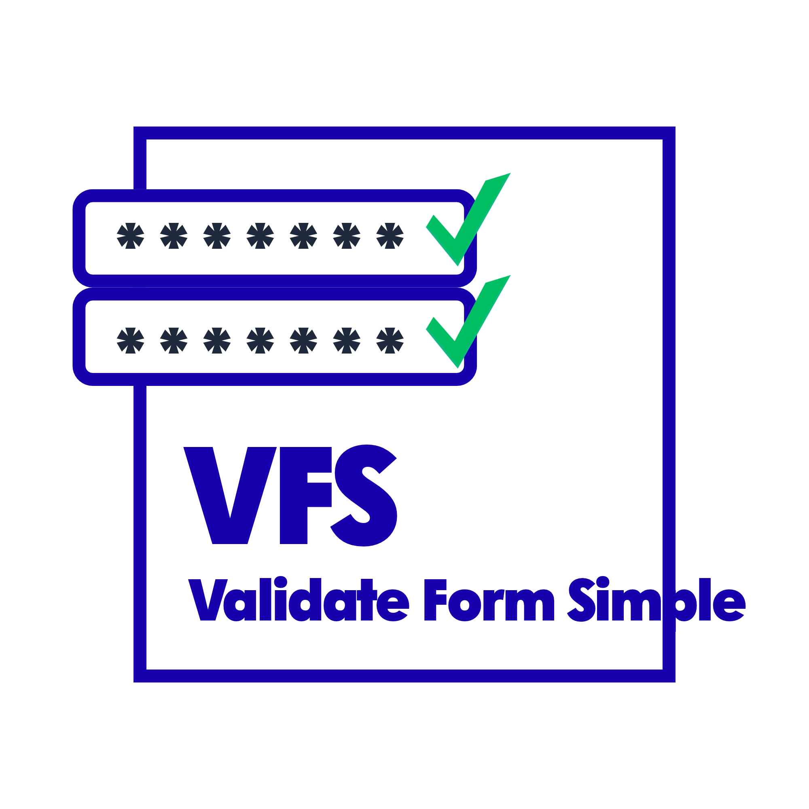

<p align="center">
  
</p>

# Validate Form Simple

**validate-form-simple** is a lightweight JavaScript library for effortless HTML form validation.

Easily add validation to your forms without writing lengthy and complex JavaScript code.  
It supports automatic checking for required fields, email format, and phone number — and is fully customizable.

---

## 📦 Installation

Install via npm:

```bash
npm install validate-form-simple
```

---

## 🛠 Development

To clone and build the project locally:

1. Clone the repository:

```bash
   git clone https://github.com/isonnymichael/validate-form-simple.git
```

2. Move into the project directory:

```bash
   cd validate-form-simple
```

3. Install dependencies:

```bash
   npm install
```

4. Build the project:

```bash
   npm run build
```

5. Run test:

```bash
   npm run test
```

6. Create a new release with changelog and version bump:

```bash
   npm run release
```

| Options         | Version |
| --------------- | ------- |
| `release:major` | `x.0.0` |
| `release:minor` | `0.x.0` |
| `release:patch` | `0.0.x` |

---

## 🏗️ Tech Stack

| Layer            | Technology                       |
| ---------------- | -------------------------------- |
| Language         | JavaScript (ESM + CJS)           |
| Bundler          | Microbundle                      |
| Testing          | Jest + jsdom                     |
| Linting & Format | ESLint + Prettier                |
| Git Hooks        | Husky + lint-staged + Commitlint |
| Release Tooling  | standard-version                 |
| Package Registry | npm                              |

## 📁 Project Structure

```bash
validate-form-simple/
├── .gitignore                   # Git ignored files config
├── LICENSE                      # License file (ISC)
├── README.md                    # Project documentation
├── dist/                        # Bundled output (ESM, CJS, UMD) from Microbundle
├── example/                     # Demo HTML file for testing in browser
│   └── index.html
├── package.json                 # Project metadata and scripts
├── src/                         # Source code for the library
│   ├── index.js                 # Main form validation logic (entry point)
│   ├── utils/                   # Utility functions (e.g. error display, field name)
│   │   └── helper.js
│   └── validators/              # Field validation functions
│       ├── email.js             # Email validation logic
│       ├── phone.js             # Phone number validation logic
│       └── index.js             # Re-exports email & phone validators
├── test/                        # Unit tests for core functionality
    └── validate-form-simple.test.js
```

---

## 🧑‍💻 Contributing

We welcome contributions from developers of all experience levels!

If you'd like to help improve this project — whether it's fixing bugs, adding features, or improving documentation — follow our contributing guide:

👉 [Read the CONTRIBUTING.md guide](./CONTRIBUTING.md)

---

## 📄 License

ISC License  
© Sonny Michael (https://github.com/isonnymichael)
